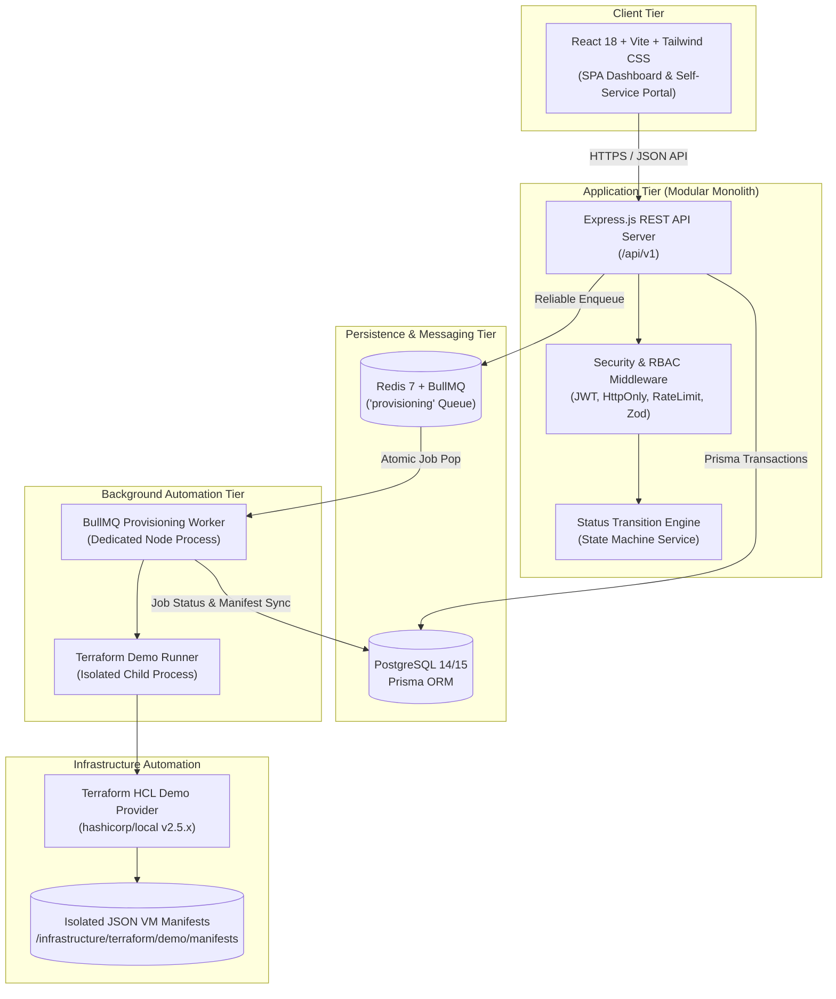
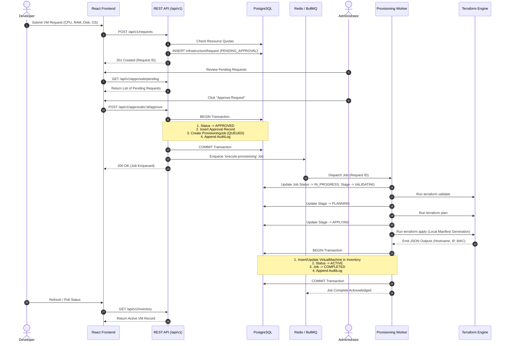

# InfraPilot — System Architecture & Workflow Specification

## 1. Executive Summary

InfraPilot is a modular monolith self-service infrastructure management platform engineered for enterprise IT organizations. It bridges development teams needing rapid virtual machine provisioning with infrastructure administrators requiring strict governance, cost control, quota enforcement, and auditability.

---

## 2. High-Level System Architecture Diagram

---

## 3. End-to-End Request & Provisioning Lifecycle

---

## 4. State Machine Transition Rules

The request lifecycle is governed strictly by `StatusTransitionService`:

| Source Status | Permitted Target Statuses | Trigger / Actor |
| :--- | :--- | :--- |
| `DRAFT` | `PENDING_APPROVAL`, `CANCELLED` | Developer submission or cancellation |
| `PENDING_APPROVAL` | `APPROVED`, `REJECTED`, `CANCELLED` | Admin approval/rejection or Developer cancellation |
| `APPROVED` | `PROVISIONING`, `FAILED` | Background Worker pickup or queue failure |
| `PROVISIONING` | `ACTIVE`, `FAILED` | Terraform apply success or execution failure |
| `ACTIVE` | `DECOMMISSIONED` | Authorized retirement of instance |
| `FAILED` | `PROVISIONING`, `CANCELLED` | Admin manual retry or cancellation |
| `REJECTED` | *None (Terminal)* | Terminal audit state |
| `CANCELLED` | *None (Terminal)* | Terminal audit state |
| `DECOMMISSIONED` | *None (Terminal)* | Terminal audit state |

---

## 5. Security & Isolation Architecture

1. **Child Process Isolation**:
   - Terraform commands run with fixed binaries, explicit argument arrays (`shell: false`), stripped environments, and execution timeouts (60s).
   - Prevents command injection and arbitrary shell concatenation.
2. **Separation of Duties (RBAC)**:
   - Developers cannot approve requests.
   - Administrators cannot approve their own submitted requests.
   - Developers cannot view or control another developer's VMs or requests.
3. **Defense-in-Depth Authentication**:
   - JWT stored in secure `HttpOnly`, `SameSite=Lax` cookies.
   - Password hashing using `bcrypt` (10 rounds).
   - Rate limiting on login endpoints (20 attempts per 15 minutes).
4. **Append-Only Auditing**:
   - System and user mutations record immutable audit events with actor, action, timestamp, and metadata.
