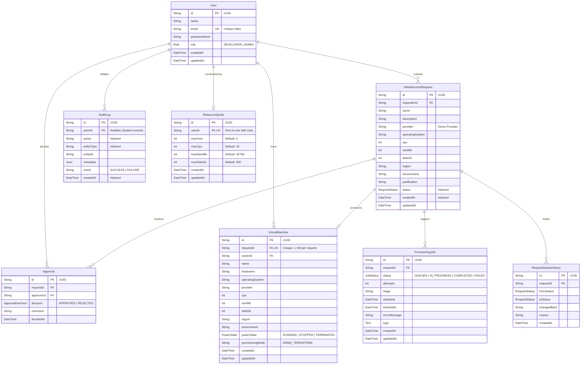

# InfraPilot — Database Design & Entity Relationship Specification

## 1. Entity Relationship (ER) Diagram

---

## 2. Relational Integrity & Constraints

1. **Unique Request-to-VM Mapping**:
   - `VirtualMachine.requestId` has a `@unique` index to physically guarantee that a single infrastructure request can never result in duplicate VM inventory records.
2. **Cascading Safety**:
   - Deleting a user cascade-cleans associated resource quotas and pending requests, but retains audit log history with `onDelete: SetNull` for actor IDs.
3. **Optimized Indexes**:
   - Compound and single-column indexes on `User(email)`, `InfrastructureRequest(requesterId, status, createdAt)`, `VirtualMachine(ownerId, powerState)`, and `AuditLog(actorId, action, entityType, createdAt)` ensure sub-millisecond query performance even under high request volumes.
4. **Calculated Aggregations vs. Stored Redundancy**:
   - Dashboard totals (such as total allocated vCPU, RAM, active VMs) are computed dynamically using aggregate database queries to prevent stale data discrepancies.
